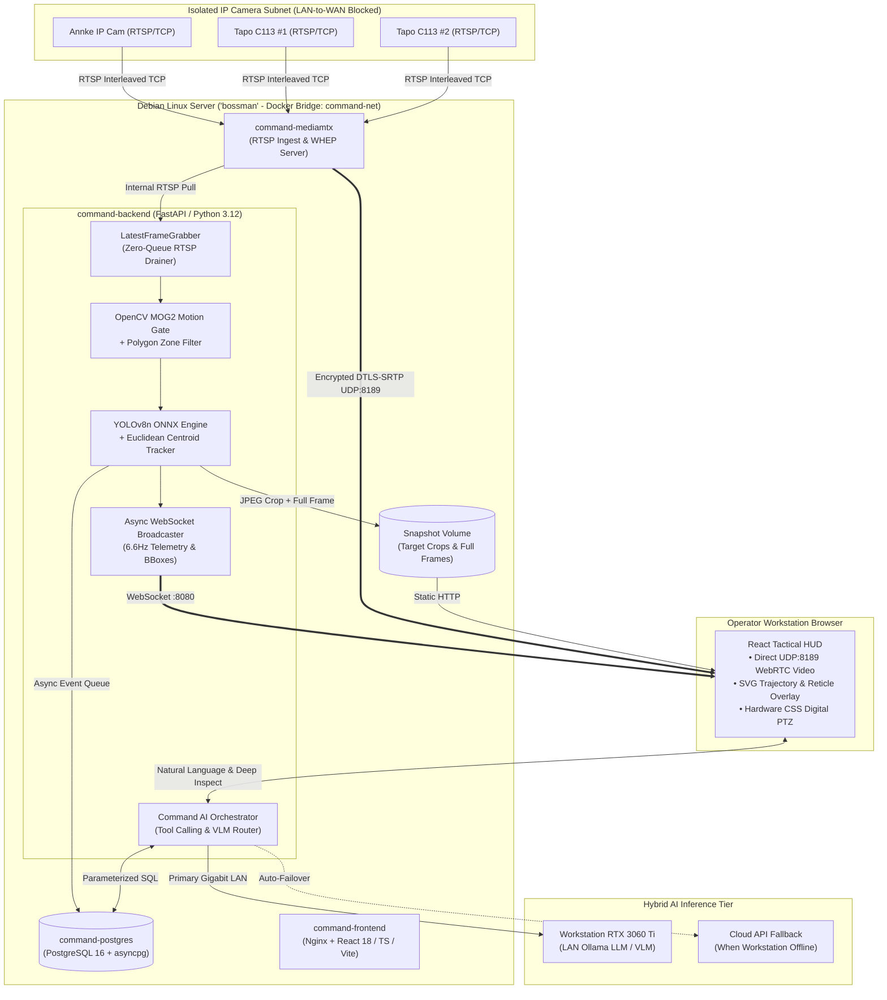

<div align="center">

# 🛡️ NASONNATION // COMMAND
**Low-Latency WebRTC Video Management System (VMS), Edge AI Vision Pipeline & Hybrid Autonomy Command Platform**

[](https://react.dev/)
[](https://www.typescriptlang.org/)
[](https://www.ietf.org/archive/id/draft-murillo-whep-03.html)
[](https://fastapi.tiangolo.com/)
[](https://onnxruntime.ai/)
[](https://www.postgresql.org/)
[](https://docs.docker.com/compose/)

</div>

---

## ⚡ Overview

**NasonNation | Command** is a self-hosted, containerized full-stack Video Management System (VMS) and edge-autonomy telemetry platform engineered for real-time situational awareness. 

Designed around the constraints of edge hardware, **Command** decouples ultra-low-latency video transport (**WebRTC WHEP over single-port UDP**) from asynchronous computer vision and AI orchestration (**FastAPI + ONNX Runtime + Hybrid LAN GPU/Cloud LLM routing**). Video streams render at native 30 FPS with sub-250ms glass-to-glass latency while the backend performs motion-gated object detection, persistent centroid tracking, automated evidence capture, and natural-language tactical tool calling.

---

## 📸 Tactical Interface Showcase

> *Screenshot below reflects the live multi-camera deployment running on Debian Linux (`bossman`).*

| **3-Camera Tactical Matrix & Kill-Feed Rail** |
| :---: | :---: |
| <br>*Live WebRTC grid with L-bracket reticles, 2.5s SVG trajectory vectors, and real-time Kill-Feed crop rail.* |

---

## 🏗️ System Architecture



---

## 🎯 Core Capabilities (The 5 Tactical Pillars)

### 1. Tactical Corner-Bracket Reticles & Centroid Vector Trails
* **Euclidean Centroid Slot Locking:** `CameraMotionTracker` matches moving objects across frames by normalized Euclidean distance so `Motion_1` stays locked onto the same physical entity without ID swapping.
* **L-Bracket HUD & Breadcrumb Vectors:** Renders segmented corner brackets, a center target pip, confidence telemetry (`M1 // PERSON · 92%`), and a 2.5-second fading SVG trajectory polyline showing target direction and velocity at zero server CPU cost.

### 2. Click-to-Focus "Theater Mode" & Auto-Tracking Digital PTZ
* **Dynamic Viewport Promotion:** Double-clicking any camera feed promotes it to a 75%-width primary Theater Viewport while stacking secondary cameras vertically on the right rail.
* **Hardware-Accelerated Digital PTZ & `AUTO-LOCK`:** Supports mouse-wheel digital zoom (`1.0x` to `5.0x`) and click-and-drag panning. Engaging **`LOCK`** automatically zooms to `2.1x` and continuously pans the viewport to keep the primary target centered in the crosshairs, easing back to `1.0x` when the scene clears.

### 3. Live "Kill-Feed" Evidence Rail & High-Res Lightbox
* **Automated Crop & Frame Extraction:** When a new target track is committed to PostgreSQL, OpenCV extracts both a padded high-res target crop (`crop_*.jpg`) and the full 1080p frame (`full_*.jpg`).
* **Real-Time Evidence Drawer:** A collapsible right-hand rail streams live target mugshots/vehicle crops with timestamps, camera IDs, and confidence scores. Clicking any card opens the full-frame capture in a modal lightbox.

### 4. Interactive Polygon Exclusion & Perimeter Tripwire Zones
* **In-Browser Zone Editor:** Operators can toggle **Zone Draw Mode** directly on any camera tile to click-and-place normalized polygon vertices (`[(x1,y1), (x2,y2), ...]`) persisted to PostgreSQL.
* **Dual Zone Logic:**
  * **Exclusion Masks (Red):** Suppresses false-positive motion/detections inside designated static regions before inference.
  * **Tripwire Perimeters (Amber):** Triggers high-priority visual/audible alerts when a `person` or `vehicle` centroid breaches a protected polygon.

### 5. Hybrid RTX 3060 Ti VLM "Deep Inspect" & Command AI Agent
* **Parasitic LAN GPU Offload with Cloud Failover:** The Debian server stays lightweight by offloading heavy LLM/Vision-Language Model (VLM) inference over gigabit LAN to an **NVIDIA RTX 3060 Ti** running **Ollama** (`llama3.2-vision` / `qwen2.5`), automatically failing over to cloud APIs if the workstation is asleep.
* **Asynchronous Target Enrichment ("Deep Inspect"):** Clicking **Inspect** on any Kill-Feed event (or triggering auto-enrichment) sends the high-res target crop to the VLM to generate detailed natural-language descriptions (e.g., *"White 4-door SUV traveling eastbound"*, *"Adult male in dark jacket carrying parcel"*).
* **Deterministic Agent Tool Calling:** Natural-language terminal bar capable of executing parameterized SQL event searches, switching camera layouts/PTZ locks via WebSocket commands, and dispatching MQTT/MAVLink hardware telemetry commands.

---

## ⚙️ Key Engineering Challenges Solved

1. **WebRTC NAT Traversal in Docker Bridge Networks:**
   Standard Docker bridge networking causes MediaMTX to advertise internal `172.18.x.x` container IPs in SDP answers, breaking LAN browser ICE negotiation. Solved without sacrificing container isolation by pinning single-port UDP muxing (`MTX_WEBRTCLOCALUDPADDRESS=:8189`) and injecting the host LAN IP via `MTX_WEBRTCADDITIONALHOSTS`.
2. **Eliminating RTSP Buffer Lag During CPU Inference:**
   Standard `cv2.VideoCapture.read()` loops block while ONNX inference executes, causing TCP RTSP buffers to accumulate multi-second delays. Solved by decoupling stream ingestion into a dedicated `LatestFrameGrabber` daemon thread per camera that continuously drains the socket, guaranteeing the CV worker always evaluates the `0ms` live frame.
3. **Preventing Event-Loop & Media Starvation on 4-Core Hardware:**
   Capped OpenCV internal threads (`cv2.setNumThreads(1)`), gated YOLOv8n execution behind an ultra-fast `0.5ms` `MOG2` pixel-motion check, serialized ONNX Runtime calls with a thread lock (`intra_op_num_threads=2`) and offloaded PostgreSQL `asyncpg` writes to a non-blocking `asyncio.Queue`.

---

## 🚀 Quickstart & Deployment

### 1. Clone & Configure Environment
```bash
git clone git@github.com:mistabowhunta/nason-command.git
cd nason-command
cp .env.example .env
cp mediamtx/mediamtx.example.yml mediamtx/mediamtx.yml
```

### 2. Build & Launch Stack
```bash
sudo docker compose up -d --build
```

### 3. Access Endpoints
* **Command Tactical UI:** `http://<HOST_LAN_IP>:3000`
* **FastAPI OpenAPI / Swagger Docs:** `http://<HOST_LAN_IP>:8080/docs`
* **Recent Detections REST Feed:** `http://<HOST_LAN_IP>:8080/api/detections`
* **MediaMTX WHEP Signaling Port:** `http://<HOST_LAN_IP>:8889/<stream_name>/whep`
